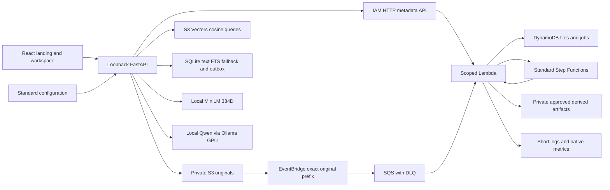

# CloudVault 3.0 architecture

The AWS event route is deliberately paused outside bounded demonstrations. The workflow validates object identity/ETag/size, extracts only hash-approved non-sensitive plaintext or records that local extraction is required, persists a derived manifest, then records awaiting-local-embedding. It does not run MiniLM or Qwen in Lambda. The laptop resumes known jobs outbound, using existing normalized embeddings and syncing their current keys to the private vector index.

Cloud vector keys bind file ID, chunk ID and text hash. Metadata includes model and scope; QueryVectors prefilters scope/model. Returned vectors must match current active local chunks, rejecting tombstones/stale content. Cloud failure or unsynced new documents triggers explicit local dense fallback. Hybrid retrieval uses local FTS/BM25 plus the selected dense provider, RRF, relative relevance gates (0.70 of the best dense score, with bounded lexical rescue), deduplication and document diversity.

DynamoDB is the cloud file/job metadata store. The backend signs HTTP API requests with temporary credentials; credentials never enter browser bundles. SQLite retains full text, original vectors, FTS, conversations and a durable conditional-revision cloud outbox. Local overlays preserve pending changes. One bounded startup resume and manual Sync waiting jobs replace continuous polling.

Generation consumes at most seven chunks/10,000 characters, two per file. Local Qwen returns structured claims, source IDs and exact quotes. Validation checks quote containment, identifiers, lexical/embedding relevance and content-word anchoring and unsupported numerals; one bounded correction precedes explicit fallback. These checks reduce citation errors but do not prove logical entailment.

CloudFormation manages the serverless stack; the existing S3 bucket, DynamoDB table and vector bucket/index remain external and preserved. The app uses no cloud-hosted frontend, public anonymous API, paid inference, NAT, VM or managed model endpoint. See AWS_RESOURCE_INVENTORY.md and CLOUD_FAILURE_RECOVERY.md.
