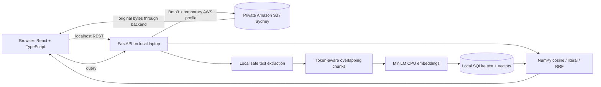

# Architecture update: version 2.0

The existing browser → FastAPI → S3 originals / SQLite metadata / local MiniLM pipeline remains. Version 2 adds FTS5 evidence retrieval and loopback Ollama/Qwen generation. See [RAG architecture](RAG_ARCHITECTURE.md) for the full retrieval, citation and fallback flow. The React Workspace replaces the former App/FileManager components and uses lazy assistant loading. No cloud worker, hosted inference or additional AWS service is introduced.

---

# Architecture



S3 is the only AWS service used by the application. STS was used once for CLI identity verification. No Lambda, Cognito, AppSync, Bedrock, vector service, EC2 or CloudFormation stack was provisioned. The HTTP interface and index are local, not hosted in AWS.

```mermaid
sequenceDiagram
 participant U as Browser
 participant A as FastAPI
 participant D as SQLite
 participant S as Amazon S3
 participant M as Local MiniLM
 U->>A: multipart file
 A->>A: validate size + sanitize name + UUID key
 A->>D: recovery metadata (uploading)
 A->>S: put original bytes, AES256, conditional new key
 A->>D: pending
 A-->>U: 201, S3 stored; indexing pending
 A->>S: fetch original for bounded extraction
 A->>M: overlapping chunks
 M-->>A: normalized 384-D float vectors
 A->>D: atomic chunks + full text + indexed status
 U->>A: poll status
 A-->>U: indexed / empty / unsupported / failed
```

## Failure boundaries

S3 and SQLite cannot share an atomic transaction. Metadata is inserted before upload so a failed request has a recoverable record. Upload failure is distinguished from indexing failure. If a process dies during an uncertain upload, reconciliation compares managed keys without automatically deleting anything. A crash during indexing marks it failed at restart; Retry re-fetches the same original. A single lock serializes indexing and deletion to avoid stale index records being recreated. SQLite uses foreign keys, WAL, parameterized queries and transactional index replacement.

## Tradeoffs

Linear vector scan is easy to explain and sufficient for a university sample set. Retrieval scores describe embedding similarity, not correctness. The entire extracted document is retained for phrase matching across chunk boundaries. The Python worker thread does extraction and inference; this is not a distributed durable job queue. For hostile documents or public deployment, isolate parsing in constrained processes and add real access control.


