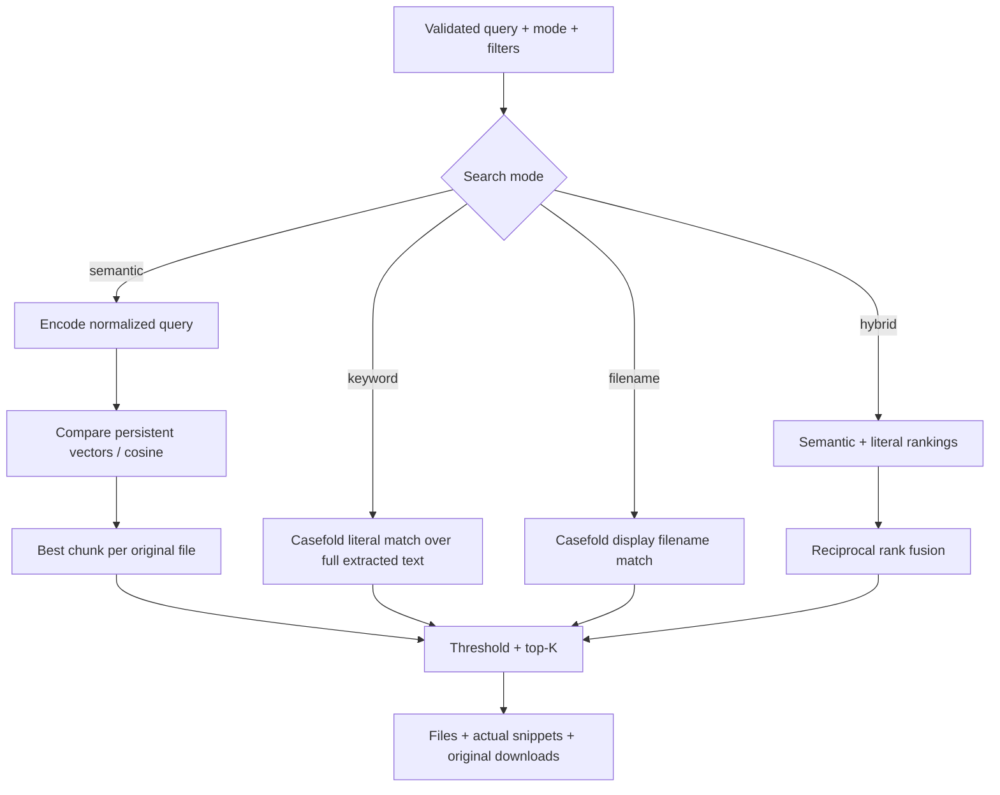

# Cloud semantic search in 3.0

MiniLM query/document embeddings are generated locally (384D, normalized). The active dense provider executes real AWS S3 Vectors QueryVectors with cosine distance, model/scope prefilters and ENHANCED query mode. Similarity is 1 minus cosine distance, bounded to [-1,1]. Results must match active local file/chunk/text-hash keys, so stale/deleted versions do not appear.

Stored original vectors were migrated and verified without re-embedding. Pending cloud indexing or SDK failure activates an explicit local matrix fallback. Filename and exact keyword modes preserve original behavior; hybrid uses FTS/BM25 and dense RRF with relative thresholds, deduplication and diversity. The frontend displays the actual response provider rather than a fixed AWS label.

All ten final curated queries rank first through actual AWS; see SEARCH_EVALUATION.md. No extra reranker/model was downloaded because this set showed no measured ranking gain to justify its memory cost.

---

## Preserved implementation detail

# Search update: version 2.0

The four original user-visible search modes and literal phrase contract remain unchanged. Semantic and hybrid searches now reuse a cached vector snapshot and bounded query embedding cache. Assistant retrieval is a separate chunk-level path: dense MiniLM plus FTS5/BM25 reciprocal rank fusion, relevance gates, deduplication and multi-file diversity. The same stored document vectors are retained. See [RAG architecture](RAG_ARCHITECTURE.md). Similarity is a cosine score, never a probability or guarantee of truth.

---

# Semantic, exact and hybrid retrieval

## Model and chunking

CloudVault uses `sentence-transformers/all-MiniLM-L6-v2`, CPU inference, 384 numerical dimensions verified at runtime. The model is loaded once per process under a lock. Downloads are cached under ignored `data/models`; a complete existing snapshot is loaded locally so a restart need not contact the model hub. Do not delete this cache before a demonstration.

Text extraction returns section/text pairs: PDF page numbers, worksheet names, or document/content labels. The fast tokenizer supplies character offsets into the original text. Windows of 220 tokens overlap by 32 and fit within MiniLM's measured sequence limit (256 including special tokens). Each chunk is checked again before encoding, preventing silent truncation. Oversized queries are rejected with an explanation. Documents are limited to 500,000 extracted characters and 3,000 chunks.

Encoding uses `normalize_embeddings=True`. Each float32 vector is stored persistently with its model identifier, actual dimension, file identifier and section. Queries use the same model. Incompatible model/dimension vectors are excluded; reindex affected files after changing the model. [Sentence Transformers API](https://www.sbert.net/docs/package_reference/sentence_transformer/SentenceTransformer.html).

## Retrieval algorithm

For normalized vectors, cosine similarity equals the dot product `document_vector @ query_vector`. NumPy computes this across compatible chunks. The best chunk per file supplies that file's semantic score and snippet. The configured threshold (default 0.25) removes low matches; top-K limits returned files. A score is a geometric similarity, not a probability or guarantee of relevance.

## Exact search

Literal matching uses Unicode casefold and complete extracted text, independent of embeddings. Enter `remotely managed` without quote characters. This deliberately treats phrases literally; it is not a boolean query language or stemming engine. Full text allows matches crossing chunk boundaries. Occurrence counts rank exact results. HTML highlighting is rendered through escaped React nodes, never `dangerouslySetInnerHTML`.

## Hybrid ranking

Semantic and literal file rankings are combined with `RRF(file) = sum(1 / (60 + rank))`, with ranks starting at 1. This avoids mixing cosine magnitudes with occurrence counts. RRF is a ranking score, not a percentage. Literal snippets are preferred for files in both lists. Original cosine similarity remains a separate response field.

## Observed demonstration results

Expected documents were defined in `samples/expected_queries.json` before running live verification. All five expected files ranked first among eight documents: storage 0.359640; network security 0.394551; machine learning 0.566055; databases 0.549624; renewable energy 0.521818. Exact and hybrid queries for `remotely managed` returned object-storage.txt. Raw, full rankings are in LIVE_VERIFICATION.json. These are small-sample observations, not a general accuracy benchmark.

