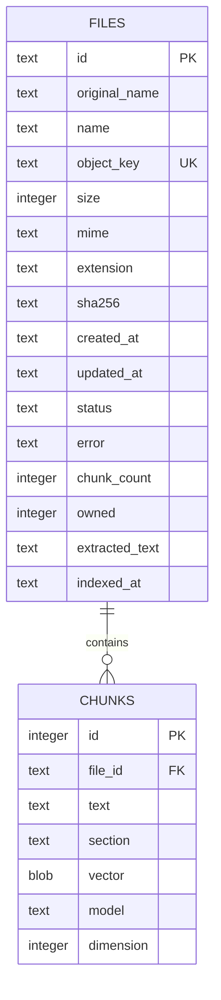

# Persistent database

SQLite lives at `CloudVault/data/cloudvault.db` by default. The path is anchored to the project directory, independent of terminal working directory. It contains sensitive extracted document text and is ignored by Git. WAL is enabled; each short connection enforces foreign keys, commits on success, rolls back on error, and closes reliably. Schema version is `PRAGMA user_version=1`.

Index replacement is transactional: old chunks are removed, new vectors inserted and file status/text updated together. Deletion cascades chunk rows. Rename changes `name` and `updated_at`; the original filename, content hash and S3 key stay stable. Object keys are unique. Duplicate filenames create independent UUID records and originals.

## Backup and recovery

Stop CloudVault before copying the entire `data` directory to a private backup. For a live backup use SQLite's backup API rather than copying just a database that may still have WAL writes. Preserve `.env` separately without committing it. Original S3 objects do not contain the complete local index. Losing SQLite loses local display names and vectors; read-only reconciliation reports untracked originals but intentionally does not mass-import them. Restore a backup or re-upload intentionally, retaining old objects until manually reviewed.

At restart interrupted pending/processing jobs become failed with retry instructions; embeddings already committed are not regenerated. The initial schema is versioned, but a general migration framework is not implemented. Do not point another app at this database or run multiple Uvicorn workers.
