# CloudVault 2.0

**Your private knowledge workspace. Store files in the cloud. Discover the knowledge inside them.**


CloudVault is an AWS-backed intelligent file management and document question-answering application. It combines **real private Amazon S3 object storage** with local semantic retrieval and retrieval-augmented generation (RAG), enabling users to find files by meaning, search exact content, and ask natural-language questions across their indexed documents with traceable source citations.

Built as a cloud computing lab project, CloudVault demonstrates a practical hybrid local-cloud architecture: original files reside in AWS, while the web application, metadata, embeddings and generative inference run locally. No hosted AI API is required.

> **Project status:** The core S3, search and local RAG workflows were reported tested in the development handover. The final landing-page, analytics, motion and visual refinement pass was requested afterward; its completion has not been independently confirmed. This README distinguishes verified development reports from the final design targets. It describes a localhost academic prototype, not a publicly deployed multi-user service.

**Local application:** http://127.0.0.1:8000 · **Interactive API documentation:** http://127.0.0.1:8000/docs

## Contents

- [Why CloudVault?](#why-cloudvault)
- [Features](#features)
- [System architecture](#system-architecture)
- [How the system works](#how-the-system-works)
- [Search and AI algorithms](#search-and-ai-algorithms)
- [Technology stack](#technology-stack)
- [User experience](#user-experience)
- [Getting started](#getting-started)
- [AWS configuration](#aws-configuration)
- [Project structure and API](#project-structure-and-api)
- [Testing and performance](#testing-and-performance)
- [Security and cost management](#security-and-cost-management)
- [Lab demonstration](#lab-demonstration)
- [Limitations and roadmap](#limitations-and-roadmap)
- [Documentation](#documentation)
- [Attribution and license](#attribution-and-license)

## Why CloudVault?

Conventional file managers are primarily designed to retrieve files by filename or exact words. As a collection grows, users may remember an idea but forget where it was written. CloudVault bridges the gap between **storage** and **knowledge retrieval**.

| Problem | CloudVault approach |
| --- | --- |
| Files stored locally are tied to a device | Original bytes are stored in private Amazon S3 objects |
| Filename search misses relevant document contents | Extract and index supported document text |
| Different wording hides relevant information | Use semantic embeddings and cosine similarity |
| Exact technical terms still matter | Preserve literal phrase and hybrid search |
| Several files may contribute to one question | Retrieve complementary passages and synthesize a grounded answer |
| AI answers can be difficult to verify | Link answer citations to actual retrieved source passages |
| Hosted AI introduces cost and privacy concerns | Run embedding and generation models locally |

## Features

### Cloud storage and file management

- Single and multiple file uploads, including drag-and-drop and transfer progress.
- Private S3 originals, unique object keys, server-side encryption and authenticated downloads.
- File list/grid views, filtering, sorting, display-name renaming, favorites and safe previews.
- Persistent metadata, indexing status, retry indexing and confirmed deletion. Live destructive S3 deletion was not exercised in the reported tests.
- Supported text extraction for PDF, DOCX, TXT, CSV, XLSX, JSON, Markdown and common text/code files. Unsupported binaries remain stored and downloadable but are not represented as content-indexed.

### Smart Search

| Mode | Purpose | Example |
| --- | --- | --- |
| Filename | Locate a file by its name | `renewable` |
| Exact | Find a literal word or phrase in extracted text | `remotely managed` |
| Semantic | Find related content despite different wording | Where can I store my files remotely? |
| Hybrid | Combine semantic and lexical evidence | cloud object storage |
| Ask CloudVault | Generate an evidence-backed answer | How can encryption and network security protect information? |

### Ask CloudVault

- Genuine local Qwen2.5 3B generation through Ollama, separate from MiniLM embeddings.
- Retrieval across all indexed documents or a selected file scope.
- Multi-document synthesis, clickable citations and relevant source previews.
- Natural-language follow-ups and persistent local conversation history.
- Citation identifiers, exact supporting quotations and claim-to-quotation relevance checks.
- Explicit insufficient-evidence and extractive-fallback modes; cancellation of active generation.

The assistant searches the indexed corpus and selects relevant passages. It does not reread every original file in full for every question, and citation checks do not guarantee that every generated claim is correct.

## System architecture

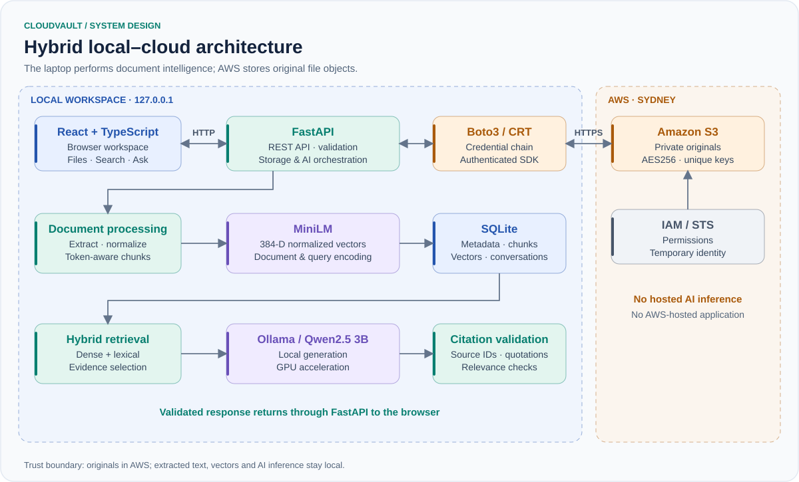

<details>
<summary>Editable Mermaid diagram</summary>

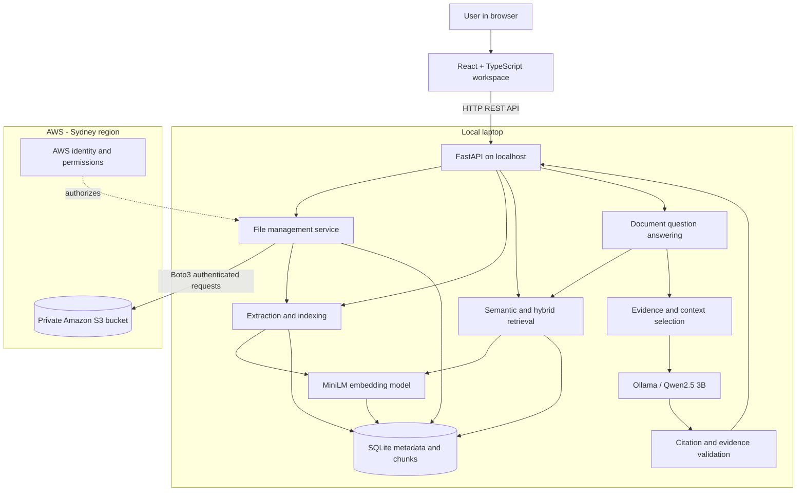

</details>

**Cloud boundary:** S3 stores original file objects. SQLite, extracted text, vectors, conversations and both AI models remain on the laptop. AWS IAM/STS authenticate cloud access; they are not application user accounts. The website is not hosted on AWS.

## How the system works

### 1. Upload and indexing pipeline

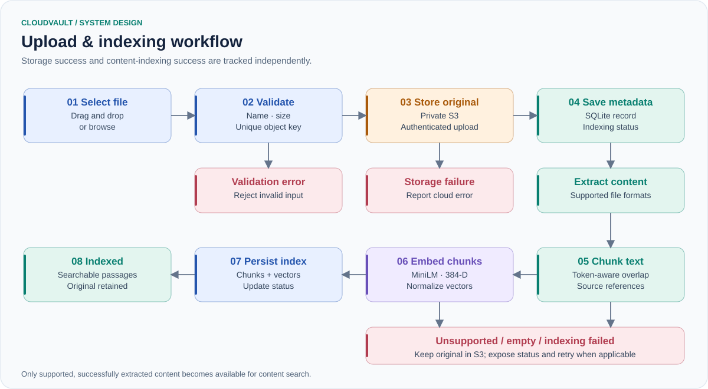

<details>
<summary>Editable Mermaid diagram</summary>

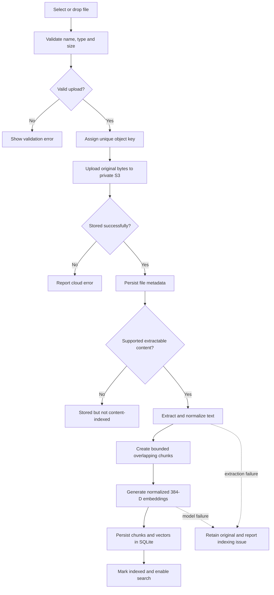

</details>

An S3 upload and local indexing are distinct operations. A file can be successfully stored even if extraction fails. The database tracks its status and supports recovery/reindexing without pretending that an unsupported file is searchable.

### 2. Search workflow

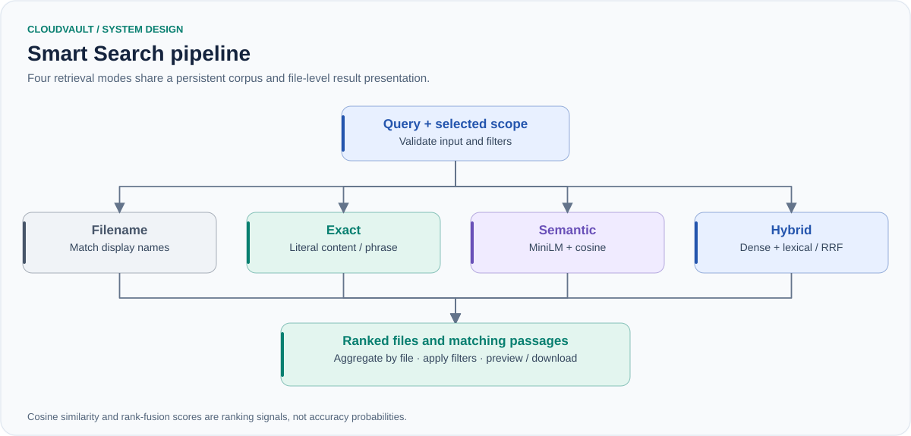

<details>
<summary>Editable Mermaid diagram</summary>

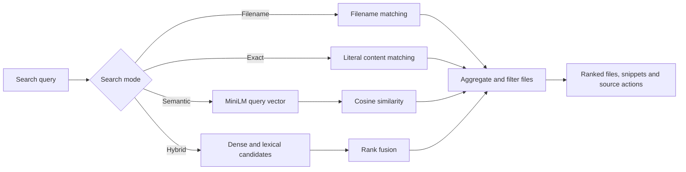

</details>

### 3. Retrieval-augmented generation (RAG)

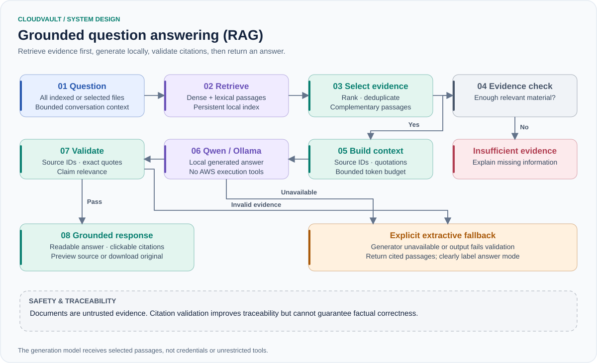

<details>
<summary>Editable Mermaid diagram</summary>

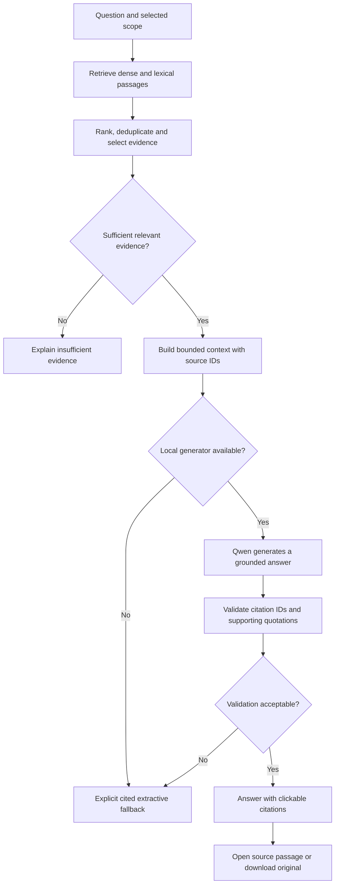

</details>

The generative model receives relevant source passages, not AWS credentials or unrestricted execution tools. Uploaded text is treated as evidence rather than instructions. The original file can be downloaded from S3 independently of whether the AI model is available.

### 4. Cloud upload and download sequence

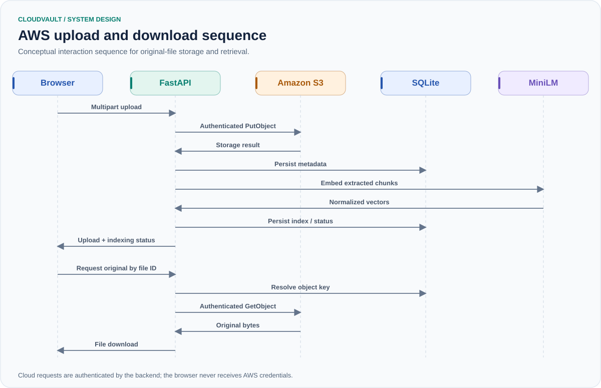

<details>
<summary>Editable Mermaid diagram</summary>

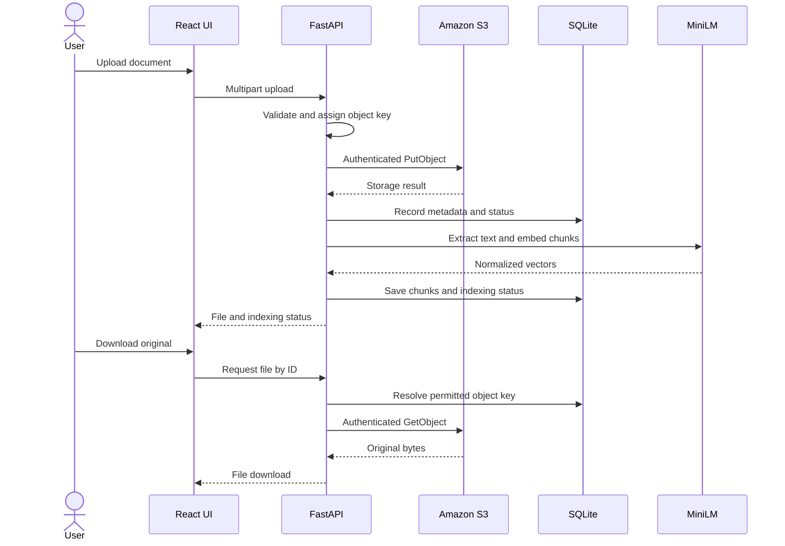

</details>

## Search and AI algorithms

### Semantic embeddings

CloudVault uses `sentence-transformers/all-MiniLM-L6-v2` to map a text chunk or query into a 384-dimensional vector. Texts with related meaning tend to occupy nearby regions of the embedding space. Chunking allows long documents to be searched at passage level while respecting the model's input length.

Cosine similarity compares query vector **q** and passage vector **d**:

```math
\operatorname{cosine}(q,d)=\frac{q\cdot d}{\lVert q\rVert_2\lVert d\rVert_2}
```

For normalized vectors this reduces to their dot product, which can be computed efficiently with NumPy. A cosine score is a ranking signal, **not** a probability of correctness or an accuracy percentage.

### Hybrid retrieval

Semantic retrieval is helpful for paraphrases; lexical and literal matching are helpful for exact identifiers, names and technical terms. CloudVault combines ranked candidates using reciprocal rank fusion (RRF), with the reported baseline using `k = 60`:

```math
\operatorname{RRF}(d)=\sum_{r\in R}\frac{1}{k+\operatorname{rank}_r(d)}
```

Candidates absent from a ranked list make no contribution for that list. File search aggregates useful passages by original file; RAG selects passage-level evidence across files. The 2.0 migration introduced lexical search support while preserving the existing embeddings.

### Local generation and citations

| Component | Responsibility |
| --- | --- |
| MiniLM | Encode queries and document chunks for retrieval |
| NumPy / SQLite | Rank vectors and persist searchable text and metadata |
| Hybrid evidence selector | Combine retrieval signals, remove duplicates and build bounded context |
| Qwen2.5 3B Q4_K_M | Generate a natural-language answer from the selected evidence |
| Ollama | Serve local model inference, with GPU acceleration when available |
| Citation validation | Check generated source IDs, exact supporting quotations and relevance |

Quantization reduces model-weight memory and disk requirements at the cost of possible quality loss. The reported Qwen weights occupy approximately 1.9 GB; runtime, context and GPU allocations require additional memory. The generator is not an embedding model and does not replace MiniLM.

## Technology stack

| Layer | Technology | Role |
| --- | --- | --- |
| Frontend | React, TypeScript, Vite | Interactive UI and production assets |
| Backend | Python, FastAPI, Uvicorn, Pydantic | Local REST API and request validation |
| Cloud | Amazon S3 | Durable original file object storage |
| Cloud access | Boto3, Botocore, AWS CRT, AWS CLI | Authenticated SDK requests and setup |
| Persistence | SQLite | File metadata, chunks, vectors and conversations |
| Extraction | PyPDF, python-docx, openpyxl, Python parsers | Supported document text extraction |
| Embeddings | Sentence Transformers, MiniLM | Semantic vector representation |
| Ranking | NumPy, lexical retrieval, RRF | Passage and file retrieval |
| Generation | Qwen2.5 3B, Ollama | Local grounded answers |
| Verification | pytest, Vitest, ESLint, Ruff | Regression and code quality checks |
| Automation | PowerShell, uv, npm | Windows setup, start, stop and warmup |

## User experience

The reported 2.0 workspace includes collapsible navigation, command search, themes, list/grid file views, starred files and a dedicated assistant with source previews. The requested final visual pass additionally targets the following design.

| Screen | Experience |
| --- | --- |
| Landing page | Product introduction, genuine product previews, architecture explanation and Open Workspace action |
| Dashboard | Actual file counts, stored bytes, indexing health, recent files and useful storage/upload analytics |
| My Files | Responsive file explorer with metadata, search, filters, favorites and contextual actions |
| Upload | Drag-and-drop queue, real transfer feedback and indexing states |
| Smart Search | Search mode selection, relevant snippets, ranking signals and original file actions |
| Ask CloudVault | Conversation workspace, document scope, grounded answers and clickable evidence |
| Settings | AWS connection and model diagnostics, appearance preferences |
| About | Architecture, project scope, contributions and attribution |

Final design goals include responsive layouts, coherent light/dark themes, keyboard focus, subtle transitions and native scrolling. Analytics must come from real data; no fabricated storage quota, activity history or accuracy metric is used as a project claim.

<!-- Add actual screenshots after the final visual pass. Example:


Use the real filenames in your repository and redact private documents or identifiers.
-->

## Getting started

### Prerequisites

- Windows with PowerShell.
- Node.js and npm (reported working versions: Node 24.19.0, npm 11.17.0).
- Python managed through uv (reported working version: 3.13.18).
- AWS CLI with a valid authorized profile and an existing private S3 bucket.
- Internet access for initial dependency/model downloads and actual S3 operations.
- Enough RAM and disk space for models. The tested laptop has an Intel i5-13420H, 16 GB RAM and RTX 4050 with 6 GB VRAM. GPU acceleration is helpful, not a universal minimum requirement.

### Obtain the source

Clone your published CloudVault repository using the URL shown by GitHub's **Code** button, or open the existing `CloudVault` directory inside your RAGStack-Lambda workspace. Run the following commands from the directory containing `frontend`, `backend` and `scripts`.

### Configure and start

```powershell
# Check the AWS CLI identity before starting.
aws sts get-caller-identity --profile default

# If your browser-login session has expired:
aws login --profile default --region ap-southeast-2

# First-time setup: use the project's configuration and locked dependencies.
.\scripts\setup.ps1

# Start the local application.
.\scripts\start.ps1

# Warm up the installed local generation model before a demonstration.
.\scripts\warmup.ps1
```

Open **http://127.0.0.1:8000**. Interactive API docs are available at **http://127.0.0.1:8000/docs**.

The setup/start/stop scripts were verified in the earlier implementation. The warmup script was repaired during 2.0 development; check its final output on your machine before relying on it. Consult the current `docs/LOCAL_AI_SETUP.md` or `docs/FINAL_HANDOVER.md` if the scripts require additional configuration.

```powershell
# Stop CloudVault's owned processes.
.\scripts\stop.ps1
```

### Manual development mode

Use two terminals from the project root if you need to edit the application. Complete setup first.

```powershell
# Terminal 1 - API
cd backend
.\.venv\Scripts\python.exe -m uvicorn app.main:app --host 127.0.0.1 --port 8000
```

```powershell
# Terminal 2 - frontend development server
cd frontend
npm run dev
```

The reported frontend development URL is `http://127.0.0.1:5173`, with an API proxy to the backend. Prefer the supplied scripts for the evaluation. Keep services bound to localhost.

## AWS configuration

CloudVault uses an existing private bucket rather than deploying a new AWS stack. In the evaluated environment the region is `ap-southeast-2` (Sydney), profile is `default`, and managed objects use the prefix `cloudvault/files/`.

Use your own authorized AWS resources. Do not publish another person's bucket name, credentials, account identifiers or login cache. Keep the actual bucket and profile in local configuration.

Illustrative environment configuration (check the actual `.env.example` for authoritative variable names):

```dotenv
AWS_PROFILE=default
AWS_REGION=ap-southeast-2
AWS_DEFAULT_REGION=ap-southeast-2
S3_BUCKET=your-private-bucket-name
S3_OBJECT_PREFIX=cloudvault/files/
EMBEDDING_MODEL=sentence-transformers/all-MiniLM-L6-v2
```

Verify access with PowerShell, replacing the example value:

```powershell
$bucket = 'your-private-bucket-name'
aws s3api get-bucket-location --bucket $bucket --profile default
aws s3api get-public-access-block --bucket $bucket --region ap-southeast-2 --profile default
aws s3 ls "s3://$bucket/cloudvault/files/" --region ap-southeast-2 --profile default
```

The SDK uses the AWS credential provider chain. Browser-based CLI login requires compatible SDK/CRT support, as demonstrated in the existing implementation. Keep all four S3 Block Public Access flags enabled. Use least-privilege access scoped to the intended bucket and managed prefix, and avoid permanent root access keys.

Typical permissions for a dedicated application identity include `s3:ListBucket` with an appropriate prefix condition and `s3:GetObject`, `s3:PutObject`, and, only if deletion is enabled, `s3:DeleteObject` on managed objects. Additional read-only diagnostics may require `s3:GetBucketLocation` and `s3:GetBucketPublicAccessBlock`. Exact authorization depends on the account policies; do not replace or broaden policies indiscriminately.

## Project structure and API

Representative layout based on the reported implementation (consult the actual source tree for complete filenames):

```text
CloudVault/
├── frontend/                # React workspace and tests
│   ├── src/
│   ├── package.json
│   └── package-lock.json
├── backend/
│   ├── app/
│   │   ├── main.py          # FastAPI entry point
│   │   ├── config.py        # Configuration
│   │   ├── database.py      # Persistence and migrations
│   │   ├── rag.py           # Retrieval and answer evidence
│   │   └── llm.py           # Local generation integration
│   ├── tests/
│   └── requirements.lock
├── scripts/                 # setup, start, stop, warmup
├── samples/                 # Non-sensitive demonstration documents
├── docs/                    # Architecture, tests, evaluation and handover
├── screenshots/             # Genuine UI captures (if included)
├── data/                    # Private local runtime data; exclude from Git
├── .env.example             # Configuration template
├── LICENSE
├── NOTICE
└── README.md
```

### API overview

Use FastAPI's live OpenAPI page for exact schemas, parameters and current endpoint availability. The following describes the principal reported API capabilities; do not assume unlisted routes are absent.

| Endpoint | Purpose |
| --- | --- |
| `GET /api/health` | Application health |
| `GET /api/search` | Search indexed files by query and mode |
| `GET /api/ai/status` | Local AI availability |
| `POST /api/ai/ask` | Ask a document-grounded question |
| File management API | Upload, list, preview, rename, download, reindex and confirmed deletion |

Example local requests:

```powershell
Invoke-RestMethod http://127.0.0.1:8000/api/health
Invoke-RestMethod http://127.0.0.1:8000/api/ai/status

$body = @{ question = 'How can encryption and network security protect information?' } | ConvertTo-Json
Invoke-RestMethod -Method Post -Uri http://127.0.0.1:8000/api/ai/ask -ContentType 'application/json' -Body $body
```

### Conceptual data model

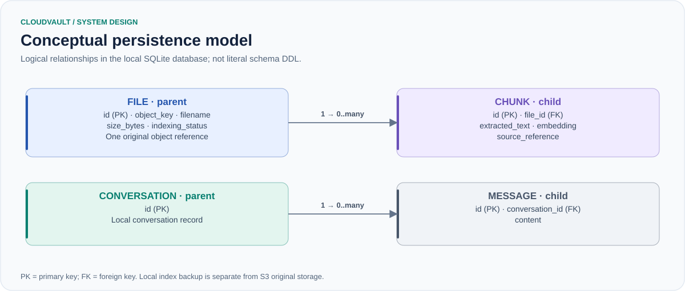

<details>
<summary>Editable Mermaid diagram</summary>

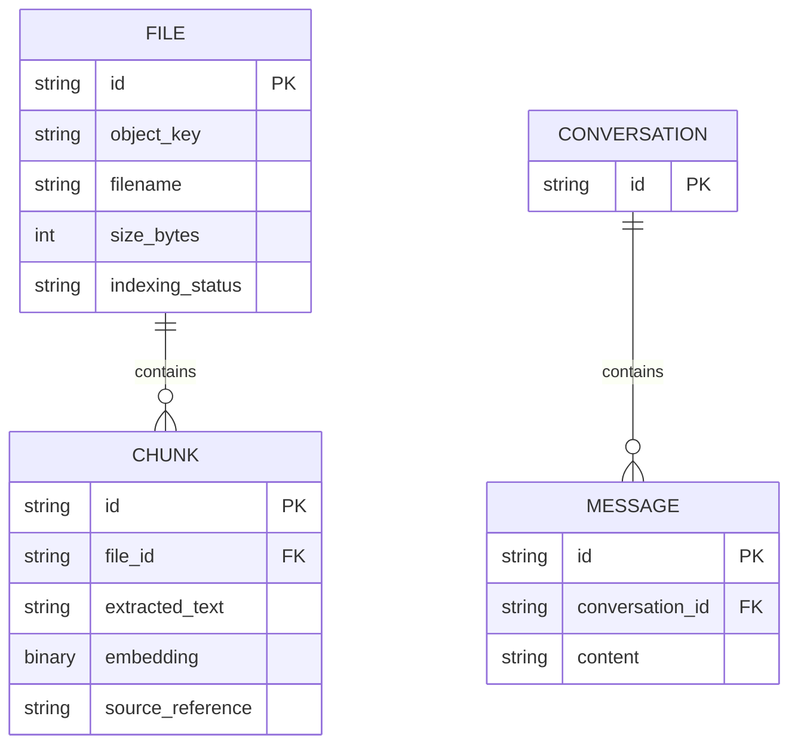

</details>

This diagram illustrates logical relationships, not literal SQLite DDL. The database is local and contains private extracted text and vectors; protect and back it up. S3 originals alone do not necessarily reconstruct all local metadata or conversation history.

## Testing and performance

The following figures are **reported development results**, not a live CI badge or a new test run conducted for this README.

| Check | Reported result |
| --- | --- |
| Backend tests | 34 passed in latest interrupted 2.0 session |
| Frontend tests | 10 passed |
| Real S3 upload/download | Original bytes matched S3 and downloaded bytes |
| Original semantic benchmark | 5/5 expected files ranked first |
| Exact and hybrid retrieval | Passed in reported verification |
| Persistence | Earlier actual restart verification passed; migration preserved IDs/vectors |
| Multi-document RAG | Real generated answer combining two documents observed in browser |
| Citations | Click opened actual supporting source passage |
| Missing evidence | Two unrelated questions correctly returned insufficient evidence |
| Warm single-document generation | 2.55 seconds, observed example |
| Warm follow-up generation | 4.45 seconds, observed example |
| Cancellation | Inference slot released in 0.19 seconds, observed test |
| Responsive assistant | 360–1680 px checks passed without horizontal overflow |

Cold generation was substantially slower than warm generation. These are small-corpus, hardware-specific observations, not general performance guarantees or broad AI accuracy benchmarks. A real S3 deletion test was deliberately omitted, and Brave blocked some automated picker/download operations; API byte integrity and user-confirmed normal downloads were independently reported. The new water-conservation fixture was uploaded through the API, not through automated browser selection.

Run current checks yourself from the project root:

```powershell
cd backend
.\.venv\Scripts\python.exe -m pytest -q
.\.venv\Scripts\ruff.exe check app tests
.\.venv\Scripts\python.exe -m compileall app
cd ..\frontend
npm run build
npm run lint
npm test
```

See `docs/TEST_REPORT.md`, `docs/LOCAL_AI_INTEGRATION.json` and the live verification evidence where present for details. The final post-redesign regression suite should be run again before publishing updated claims.

## Security and cost management

- Originals are private S3 objects; reported integration tests confirmed AES256 server-side encryption and all four public-access-block flags.
- The backend uses authenticated SDK requests. No AWS secrets belong in browser code or Git.
- Local services are loopback-only with host/origin checks; this is not a public multi-user application.
- Filename validation, upload limits, safe previews and parameterized database operations reduce application risks.
- Document content is untrusted. The local generator cannot execute shell commands or perform AWS mutations; citations and quotations are validated before presentation.
- Local AI avoids hosted inference API charges. AWS storage, requests and data transfer can consume credits or incur charges depending on account terms. The project does not require upgrading the account or provisioning EC2, RDS, OpenSearch or Bedrock infrastructure.
- Bedrock model invocation was restricted in the evaluated account. Local inference was selected rather than attempting to circumvent the restriction.

Before publishing, ensure `.env`, credential files, SQLite databases and backups, model weights, `.runtime`, `data`, private uploads, virtual environments, node_modules and sensitive logs are excluded. Review existing tracked files and Git history as well; `.gitignore` does not remove already committed secrets.

## Lab demonstration

A suggested six-minute walkthrough:

| Time | Demonstration |
| --- | --- |
| 0:00–0:45 | Introduce the problem and open the workspace; show landing page if completed |
| 0:45–1:30 | Explain dashboard, AWS region, private bucket and local AI model status |
| 1:30–2:30 | Upload a non-sensitive document and verify its real object in the S3 console |
| 2:30–3:30 | Show exact phrase search and semantic retrieval with different wording |
| 3:30–4:45 | Ask a multi-document question, inspect citations and ask a follow-up |
| 4:45–5:30 | Download the original and explain the S3/local index boundary |
| 5:30–6:00 | Summarize architecture, privacy, cost and limitations |

### Suggested pitch

> CloudVault is an intelligent cloud storage and document knowledge workspace. It stores original files securely in Amazon S3, indexes supported document contents using local MiniLM embeddings, and uses a local Qwen model to answer questions from retrieved evidence with verifiable citations. This hybrid architecture demonstrates genuine cloud storage and modern AI retrieval while avoiding dependence on paid AI APIs.

### Demonstration queries

| Question | Expected capability |
| --- | --- |
| Where can I store my digital files remotely? | Semantic retrieval of object-storage content |
| How do computers learn from examples? | Semantic retrieval of machine-learning content |
| `remotely managed` | Exact phrase retrieval |
| How can encryption and network security protect information? | Multi-document RAG |
| Which specific controls should we combine, and why? | Follow-up in the security conversation |
| How can farmers reduce avoidable water loss? | Scoped question about the water-conservation fixture |

Before the evaluation, verify AWS login, start the application, warm the local model and rehearse with the actual sample files. If generation is unavailable, demonstrate the clearly labeled extractive fallback and ordinary semantic search. Do not misrepresent fallback as generated synthesis.

## Limitations and roadmap

### Current boundaries

- Single-user localhost application; no production multi-tenant authentication or public deployment.
- Text-based indexing; scanned PDFs and arbitrary image/audio/video contents are not searchable unless separate extraction is implemented.
- The local index needs backup or controlled reconstruction; it is not a managed cloud database.
- Compact local generation can be wrong, and citation relevance checks are not proof of factual correctness.
- Small-scale linear vector retrieval and laptop inference are not validated for large production workloads.
- Live destructive AWS deletion, full browser matrix, comprehensive accessibility and hostile-parser stress testing were not completed in the reported baseline.

### Future work

- OCR and broader multimedia extraction.
- Durable background indexing workers and controlled index reconstruction.
- Larger independent retrieval/grounding benchmarks; optional lightweight reranking if measured improvements justify it.
- Multi-user authorization and deployment with a separately assessed security and cost model.
- Final design refinement: landing page, real-data analytics charts, motion, scrolling and full visual regression review where not yet completed.

## Documentation

The implementation handover references these files under `docs/`. Use the actual repository contents as the source of truth; some 2.0 documents may still be pending the final interrupted quality pass.

| Document | Purpose |
| --- | --- |
| `FINAL_HANDOVER.md` | Startup, implementation and readiness summary |
| `ARCHITECTURE.md` | System design |
| `SEMANTIC_SEARCH.md` | Retrieval and embeddings |
| `RAG_ARCHITECTURE.md` | RAG and evidence validation, if completed |
| `LOCAL_AI_SETUP.md` | Model runtime setup, if completed |
| `TEST_REPORT.md` | Actual tests and limitations |
| `EVALUATION_GUIDE.md` | Demonstration procedure |
| `VIVA_QUESTIONS.md` | Technical viva preparation |
| `PROJECT_REPORT.md` | Academic project report |
| `PROJECT_CONTRIBUTIONS.md` | Upstream reuse and modifications |
| `SECURITY.md` | Security boundaries |
| `COST_AND_CLEANUP.md` | AWS cost and safe cleanup |

## Attribution and license

CloudVault is a customized academic implementation based on the open-source [RAGStack-Lambda](https://github.com/HatmanStack/RAGStack-Lambda) project by HatmanStack and its contributors. The upstream implementation uses the Apache License 2.0; preserve its copyright notices, `LICENSE` and `NOTICE` when redistributing applicable code. See the actual project license and notices for the terms governing the customized distribution and any third-party components.

CloudVault's reported modifications include a separate local React/FastAPI application, private S3 integration, persistent SQLite indexing, local semantic and hybrid retrieval, a local RAG assistant, evidence validation, redesigned file management, setup automation and evaluation documentation. AI-assisted development should be acknowledged in accordance with institutional requirements.

Third-party models, libraries, fonts and runtime software remain subject to their respective licenses. Useful technical references include [Amazon S3 documentation](https://docs.aws.amazon.com/s3/), [Boto3 documentation](https://boto3.amazonaws.com/v1/documentation/api/latest/index.html), [FastAPI](https://fastapi.tiangolo.com/), [Sentence Transformers](https://www.sbert.net/), [MiniLM model card](https://huggingface.co/sentence-transformers/all-MiniLM-L6-v2), and [Ollama](https://ollama.com/).

---

**CloudVault** — cloud storage, intelligent retrieval and evidence-backed answers in one private workspace.
