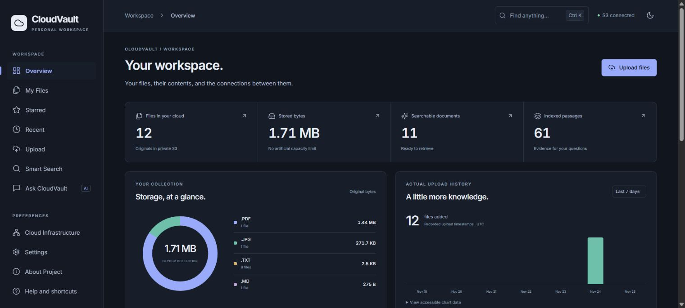

# CloudVault 3.0

**Private cloud storage. Search by meaning. Answers with evidence.**

CloudVault combines real AWS storage, metadata, vector retrieval and bounded serverless processing with a polished React workspace and private local AI generation. Built for a cloud computing lab, it shows what actually runs in AWS and what stays on your laptop.



## What it does

- **Manage originals:** private S3 uploads and downloads, file grid/list, stars, filters, safe previews and upload progress.
- **Find information:** filename, exact keyword, semantic and hybrid search; actual S3 Vectors retrieval with explicit local fallback.
- **Ask across documents:** local Qwen generation, multi-document evidence, clickable citations, follow-ups, conversation history and Stop.
- **Inspect the cloud:** actual AWS service evidence, ingestion histories, timestamped native metrics and clear cloud/local boundaries.
- **Use a complete workspace:** landing page, direct routes, light/dark/system themes, keyboard navigation and responsive charts.

## Architecture

| AWS | Local laptop |
|---|---|
| S3 original files | React + TypeScript workspace and FastAPI |
| S3 Vectors semantic query execution | MiniLM 384D embedding generation |
| DynamoDB file metadata and job state | SQLite extracted text, FTS, conversations and fallback vectors |
| EventBridge → SQS/DLQ → Lambda → Standard Step Functions | Outbound completion of awaiting-local embedding jobs |
| IAM-authenticated API Gateway, Standard SSM, CloudWatch | Qwen2.5 3B through loopback Ollama |
| Scoped IAM and CloudFormation | Citation validation, bounded correction and explicit fallback |

The native ingestion chain was exercised using a non-sensitive fixture. AWS never calls localhost: the cloud workflow records an awaiting-local stage, and the laptop completes it outbound. Cloud text artifacts are restricted to explicitly approved fixtures; full extracted text and conversations otherwise stay local.

The HTTP API is publicly routable HTTPS but every route requires AWS_IAM. Credentials stay on the backend. This is a single-user localhost application, not a public multi-tenant service.

## Run locally

The Windows development installation already has its runtime and models. From the repository root:

```powershell
cd CloudVault
./scripts/start.ps1
./scripts/warmup.ps1
```

Open **http://127.0.0.1:8000**. Dashboard: `/workspace`; files: `/workspace/files`; search: `/workspace/search`; assistant: `/workspace/ask`; infrastructure: `/workspace/cloud`; OpenAPI: `/docs`.

For a fresh installation, read the [project README](CloudVault/README.md), [AWS setup](CloudVault/docs/AWS_SETUP.md) and [local AI setup](CloudVault/docs/LOCAL_AI_SETUP.md) first. Configure your own private environment and AWS login. Normal startup does not require downloading the models again. Cloud provisioning is separate and must not be run blindly.

## Verification

| Check | Recorded result |
|---|---|
| Backend regression | 46 passing tests |
| Frontend regression | 12 passing tests; TypeScript/Vite, ESLint and Ruff checks passed |
| Curated semantic evaluation | 10/10 expected documents ranked first through actual AWS queries |
| Responsive checks | 90 route/width combinations from 320 to 1920 pixels without horizontal overflow |
| Actual cloud | Vector/metadata read-back, native ingestion, signed API, workflow failures, duplicate handling, logs/metrics and bounded DLQ verification |
| Preservation | Unaffected original documents, original vectors and prior conversations checked against the preserved backup |

These are recorded development results, not universal accuracy, load, security or accessibility certifications. Actual cloud/model evidence is distinguished from isolated unit tests. Model answers can fail validation; unsupported details are omitted or explicitly replaced with source excerpts.

## Financial and privacy boundaries

The implementation was restricted to the existing AWS Free plan and eligible promotional credits, with **zero out-of-pocket expenditure authorized**. No Paid-plan upgrade, paid AI API, NAT gateway, VM or hosted model endpoint was introduced.

The application fails closed when Free-plan eligibility or the credit reserve cannot be verified. EventBridge routing and the SQS consumer are paused between bounded rehearsals. API throttling, finite retries and short log retention limit usage. Retained storage and requests can still consume credits; an application guard is **not an AWS billing cap**. Verify your own current account eligibility before using or provisioning resources.

Credentials, `.env`, databases, uploads, models, backups and runtime binaries are excluded from Git. Published evidence contains project/sample metadata and genuine screenshots, not a portable copy of the private working database.

## Documentation

- [Final handover](CloudVault/docs/FINAL_HANDOVER.md) and [requirements status](CloudVault/REQUIREMENTS_STATUS.md)
- [Architecture](CloudVault/docs/ARCHITECTURE.md), [AWS inventory](CloudVault/docs/AWS_RESOURCE_INVENTORY.md) and [permission matrix](CloudVault/docs/AWS_PERMISSION_MATRIX.md)
- [Actual AWS verification](CloudVault/docs/AWS_LIVE_VERIFICATION.md), [cost controls](CloudVault/docs/AWS_COST_ESTIMATE.md) and [failure recovery](CloudVault/docs/CLOUD_FAILURE_RECOVERY.md)
- [RAG architecture](CloudVault/docs/RAG_ARCHITECTURE.md), [search evaluation](CloudVault/docs/SEARCH_EVALUATION.md) and [test report](CloudVault/docs/TEST_REPORT.md)
- [Lab demonstration](CloudVault/docs/EVALUATION_GUIDE.md), [project report](CloudVault/docs/PROJECT_REPORT.md) and [viva questions](CloudVault/docs/VIVA_QUESTIONS.md)
- [Known limitations](CloudVault/docs/LIMITATIONS.md), [security](CloudVault/docs/SECURITY.md), [cleanup](CloudVault/docs/COST_AND_CLEANUP.md) and [resume checkpoint](CloudVault/RESUME_CHECKPOINT.md)

## Attribution

CloudVault extends [RAGStack-Lambda](https://github.com/HatmanStack/RAGStack-Lambda). Original upstream source, [LICENSE](LICENSE) and [NOTICE](NOTICE) are retained. CloudVault-specific application code, infrastructure, scripts, screenshots and documentation are under `CloudVault/`. AWS, React, FastAPI, MiniLM, Qwen and Ollama remain their respective projects; this repository claims no affiliation with their providers.
